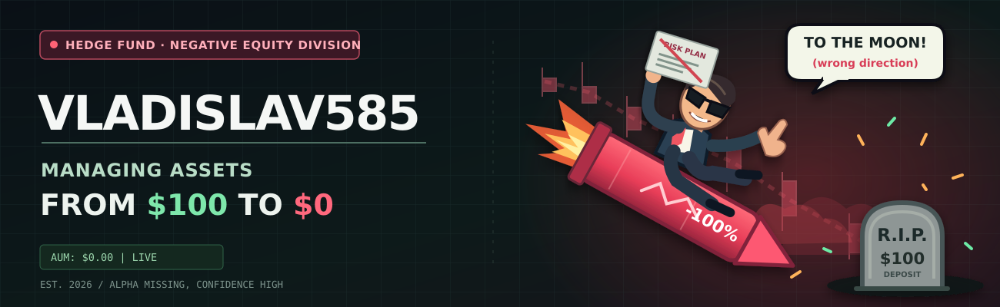

# Vladislav585

### Quant Researcher · Algorithmic Trader · Portfolio Manager · Liquidity Provider · Pocket Option Survivor · Остальное на стопе

Разрабатываю финансовые системы полного цикла: **от мысли «щас разбогатею» до вопроса «куда, блядь, делись деньги?»**.

Специализируюсь на Quantitative Finance, Systematic Trading, Portfolio Optimization, Statistical Arbitrage, Machine Learning и прогнозировании движения цены за пять секунд до экспирации.

> Рынок может оставаться иррациональным дольше, чем я — платёжеспособным. Поэтому я пишу код.

---

## About me

- Ищу закономерности в движении цен. Обычно они исчезают сразу после того, как я ставлю на них деньги.
- Строю торговые стратегии на Python. На исторических данных я, сука, практически миллионер.
- Проверяю стратегии на исторических данных. Как только добавляю комиссии, яхта идёт нахуй.
- Разрабатываю **Lonvelt** — собственную платформу анализа рынков, исследования активов и конструирования портфелей.
- Исследую Pocket Option. Пять секунд на решение, потом двадцать минут: «Какого хуя я нажал?»
- Открыт к исследовательским задачам, Quant Research и бесплатному Bloomberg Terminal.

## Technical Expertise

| Направление | Технологии, методы и компетенции |
| --- | --- |
| **Quantitative Research** | Alpha Research, Hypothesis Testing, t-statistics, p-values, Confidence Intervals, научно доказываю, что деньги действительно потеряны |
| **Algorithmic Trading** | Signal Generation, Strategy Rules, Entry / Exit Logic, автоматизация решений, за которые раньше было стыдно только мне |
| **Systematic Strategies** | Momentum, Trend Following, Mean Reversion, Breakout, стратегия «ну сейчас точно развернётся» |
| **Statistical Arbitrage** | Pairs Trading, Cointegration, Z-Score, Spread Modeling, если две акции падают одновременно, значит, они, блядь, встречаются |
| **High-Frequency Trading** | Tick Data, Market Microstructure, Latency, Execution, настолько быстрые сделки, что «блядь» произношу уже после |
| **Pocket Option Research** | Binary Options, Expiration Time, 5-second Forecasting, Technical Indicators, научный ответ на вопрос «куда, блядь, делись сто долларов?» |
| **Technical Analysis** | RSI, MACD, EMA, SMA, Bollinger Bands, ATR, Support / Resistance, рисование линии до получения нужного сигнала |
| **Financial Time Series** | Returns, Volatility, Autocorrelation, Stationarity, ADF, ARIMA, прогнозирование вчерашнего рынка |
| **Econometrics** | OLS, CAPM, Factor Models, Beta, Alpha, R², график охуенный, денег нет |
| **Factor Investing** | Value, Size, Quality, Momentum, Fama–French, чем больше умных слов, тем сложнее объяснить убыток |
| **Portfolio Optimization** | Mean–Variance, Efficient Frontier, Sharpe Ratio, SciPy, Clarabel, математически вычисляю, где меня наебут |
| **Risk Management** | Position Sizing, Stop-Loss, ATR Stops, Drawdown, VaR, CVaR, если не ставить стоп, он, сука, и не сработает. Думайте. |
| **Backtesting** | Walk-Forward, Out-of-Sample, Transaction Costs, Look-Ahead Bias, Data Leakage, удаление комиссий ради презентации |
| **Performance Analysis** | Sharpe, Sortino, Calmar, Max Drawdown, Profit Factor, Win Rate, ищу хотя бы одну цифру, которую не стыдно показать |
| **Machine Learning** | Linear / Logistic Regression, Random Forest, CatBoost, XGBoost, алгоритм изучил тысячу графиков и выдал: «А хуй его знает» |
| **Deep Learning** | PyTorch, TensorFlow, MLP, CNN, LSTM, Transformers, чем дороже видеокарта, тем убедительнее убыток |
| **Hyperparameter Tuning** | Grid Search, Random Search, Cross-Validation, меняю настройки, пока прошлое не станет прибыльным |
| **Monte Carlo** | Bootstrap, Resampling, Scenario Simulation, тысяча сценариев, в каждом брокер спрашивает: «Ты там охуел?» |
| **Market Data** | MOEX, Yahoo Finance, Binance, OHLCV, корпоративные события, два источника данных: оба пиздят, но по-разному |
| **Data Engineering** | Python, SQL, Pandas, NumPy, PyArrow, Parquet, SQLite, файлы `final_final_really_final.csv` |
| **Optimization** | SciPy, Numerical Optimization, Convex Constraints, ищу способ заработать много, быстро и без риска; пока не нашёл |
| **Software Engineering** | Git, GitHub, REST API, Node.js, Docker, Linux, дебаг после уверенного «да всё заебись, работает» |
| **Behavioral Finance** | Loss Aversion, Overconfidence, FOMO, Prospect Theory, изучаю психологию трейдера на самом дорогом испытуемом — себе |
| **Capital Preservation** | Diversification, Rebalancing, Cash Management, если проебал депозит, главное не проебать пароль от демосчёта |
| **Foundation Models** | CAPM, Fama–French 3/5 Factors, фундаментальный анализ; строю финансовый фундамент; пока больше похоже на котлован |

## Investment Philosophy

> **Запомните, пацаны:** чем больше у вас денег, тем меньше у вас меньше денег. А когда денег нет, то их нет, потому что они были, а теперь нет. Вот почему я в финансах.

- Волк не торгует по индикаторам. Волк в лесу. У него лапы. Какой, нахуй, RSI?
- Кто рано встаёт, тот рано встаёт. Кто поздно — поздно. А я, блядь, в минусе в любое время суток.
- Девушка спросила, вижу ли я наше будущее. Я сказал: «На исторических данных всё прекрасно».
- Мне говорили: «Деньги должны работать». Я отправил их на Pocket Option. С тех пор на связь не выходят.
- Я родился с нулём рублей. И, несмотря на все препятствия, упорно возвращаюсь к истокам.
- Пацаны, если не знаете, куда идти — идите вперёд. Если там стена — ну всё, пиздец, уровень сопротивления.
- Меня спрашивают, когда я стану миллионером. Я уже был. На ёбаном демосчёте.
- Сильный не тот, кто упал и поднялся. Сильный тот, кто упал, поднялся, снова упал и назвал это коррекцией.

## Investment Committee

<p align="center">
  
</p>

## Programming Languages

| Language | Proficiency |
| --- | --- |
| Python | Advanced |
| SQL | Working proficiency |
| JavaScript | Когда без него уже никак |
| Pine Script | Читаю, пока TradingView не попросит подписку |
| MQL5 | Уважаю на расстоянии |
| Excel | `=ЕСЛИ(прибыль>0;"гений";"переобучение")` |

## Languages

**Russian** — Native · **English** — Research Papers & Stack Overflow · **Market Language** — понимаю, когда уже поздно

## Projects & Achievements

| Project | What I did | Result |
| --- | --- | --- |
| **Lonvelt** *(private)* | Собственная desktop-платформа для анализа акций, финансовых данных, построения и исследования индивидуальных инвестиционных портфелей. | Теперь могу найти причины не покупать актив сразу по нескольким направлениям. |
| [SBER MOEX Trading Strategy](https://github.com/Vladislav585/sber-moex-trading-strategy) | Исследование торговых сигналов, параметров стратегии и исторических данных SBER. | История отлично знает, когда нужно было покупать. |
| [AI Trading Agent — Quantitative Core](https://github.com/Vladislav585/AI-Trading-Agent-Trading-Core) | Мультитаймфреймовый анализ, оценка сигналов, контроль риска; проект для MOEX AI Hackathon. | У алгоритма есть торговая логика. Осталось договориться с рынком. |
| [MOEX Investment Portfolio](https://github.com/Vladislav585/investment-portfolio-ml) | Построение портфелей, оптимизация, walk-forward и out-of-sample тестирование. | Диверсифицировал источники тревоги. |
| [Quant Learning Path](https://github.com/Vladislav585/Quant_Learning_path) | Статистика стратегий, временные ряды, факторы, бэктестинг, управление риском. | Чем больше изучаю рынок, тем меньше хочу обещать доходность. |
| [Stock Price Linear Regression](https://github.com/Vladislav585/Linear-regression-in-stock-price) | Линейная регрессия для анализа и прогнозирования цен. | Линия получилась прямой. Рынок — нет. |

## Selected achievements

- **MOEX AI Hackathon 2026 — Top 50.** Разрабатывал количественную часть торгового агента. Торговый агент хотя бы не пытался отыграться после убытка.
- **ArenaData 2026 — Top 6.** [Поиск персональных данных](https://github.com/Vladislav585/Automatic-detection-of-personal-data-ArenaData-). Персональные данные нашлись. Секрет прибыльной торговли — нет.
- **X5 Growth Gradient 2026 — Top 20.** [Прогнозирование розничного товарооборота](https://github.com/Vladislav585/X5-Pyaterochka-RTO-forecast). Прогнозировать товарооборот оказалось спокойнее, чем следующую минутную свечу.
- Настроил систему оценки рисков. Теперь знаю точный размер проблемы ещё до её появления.
- Достиг **100% воспроизводимости** результата: при одинаковых ошибках получаю одинаковые ошибки.

## Research Interests

Quantitative Finance · Market Microstructure · Statistical Arbitrage · Alpha Decay · Momentum · Mean Reversion · Factor Models · Volatility Forecasting · Portfolio Construction · Risk Parity · Bayesian Inference · Reinforcement Learning · Transaction Costs · Slippage · Regime Detection · Overfitting · Survivorship Bias · Binary Options · Pocket Option · Recovery After Margin Call · Learning to Stop Trading · Learning to Stop Learning to Stop Trading

## Current Focus

```text
ПЛАН: Купить на самом дне.
РЕЗУЛЬТАТ: Нашёл второе дно.
ДЕЙСТВИЕ: Докупил.
НОВОСТИ: Обнаружено третье дно.

ВЫВОД: Я не трейдер. Я ебаный геолог.
```

> **Основной принцип:** если упало на 90%, то ещё на 90% уже не упадёт. Наверное.

## Profile Analytics

<p align="center">
  
  
  
</p>

<table>
  <tr>
    <th>GitHub Performance</th>
    <th>Contribution Consistency</th>
  </tr>
  <tr>
    <td width="50%"></td>
    <td width="50%"></td>
  </tr>
  <tr><th colspan="2">Market-Neutral Commit Portfolio</th></tr>
  <tr>
    <td colspan="2"></td>
  </tr>
  <tr>
    <th>Repository Language Allocation</th>
    <th>Alternative Portfolio Allocation</th>
  </tr>
  <tr>
    <td></td>
    <td></td>
  </tr>
  <tr><th colspan="2">Contribution Equity Curve</th></tr>
  <tr>
    <td colspan="2"></td>
  </tr>
</table>

<p align="center"><sub>Диаграммы не доказывают, что я шарю. Но, блядь, выглядят солидно.</sub></p>

---

<p align="center">
  <b>Прошлые успехи не гарантируют будущих. Особенно если успехи были только на графике.</b>
</p>
<p align="center">
  <a href="https://github.com/Vladislav585">GitHub</a> · <a href="https://t.me/lonvelt">Lonvelt Telegram</a>
</p>
